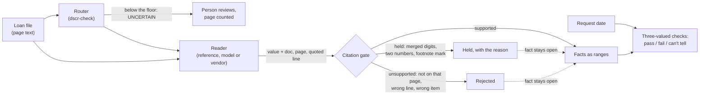

# lending-checks

Two loan-file checks that take no value on a reader's word.

- **lienstack** reads a preliminary title report's Schedule B and the mortgage statements in a
  file, then checks the lien conditions a second-lien HELOC guide prints: the new line records
  second, behind a first lien seasoned 12 months, with no senior line of credit, recorded tax
  lien, judgment or reverse mortgage. A recorded lien those rules don't name (a mechanic's lien,
  an association lien, a lis pendens) reads "can't tell" for a person, never "pass". Combined
  loan-to-value comes out as a range that only cited liens and cited balances can narrow.
- **dscr-check** routes a DSCR file's pages, reads the rent schedule, lease, note, tax bill,
  insurance declarations and association dues, and scores DSCR (qualifying rent ÷ PITIA) as a
  range against each overlay's floor. A missing lease, an expired policy or a garbled tax total
  can't pass a file; at best it reads "can't tell".

Both run on one rule. A reader (the reference reader here, a model, or a vendor extractor)
only proposes a value and quotes the document, page and line that print it. Code decides
whether the value stands, and every check is three-valued over the range of values the
documents allow: it passes only if it holds for all of them, fails only if it holds for none,
and otherwise says what fact would settle it.

TypeScript on Node 22.18+, no runtime dependencies, MIT. Every document in this repository is
synthetic. No model or vendor service is called anywhere in it.

## Why I built this

I was a loan officer at New American Funding from 2019 to 2021, licensed in 14 states, and back
on live loans at Loan Factory from June to August 2026. My files closed through title and
escrow. The lesson in this repository came from software I built myself:

- **December 14–15, 2025.** I built a one-day DSCR demo for a mortgage-tech company. Agents
  sorted loan PDF pages into seven classes, one of them `UNCERTAIN` for a person, extracted the
  rent schedule, and scored DSCR, and every reviewer's "Bad Output" click went into a golden set.
  The payment and expenses behind that score were hard-coded ($3,150 a month, $8,200 a year).
- **October 4, 2026.** Transcribing lenders' HELOC grids into my own HELOC engine, I found
  second-lien cells printed with merged tracked changes (`$375400,000`, `75%85%***`). I held them
  with a written reason instead of guessing. The same day I kept a DSCR cash-out grid blocked,
  because it turns on rent coverage, which that engine's questions don't ask.
- **October 5, 2026.** I pulled every price off that engine's page because no rate sheet could
  be proven current, and wrote the rule down: a value counts only if a dated source backs it on
  the day you ask.

That engine checks every borrower answer as a range, so "not sure" can never become a fit.
lienstack points the same rule at the title report: "Do you have another loan against this
home?" gets answered from recorded liens instead of a guess. dscr-check is the December demo
rebuilt with it, with the payment and expenses read from documents or left open.

## How it decides



**The citation gate** (`src/core/evidence.ts`). A proposed value is *supported* only if the
quoted text is on the cited page, sits on the one printed line that labels that field (and, for
a Schedule B item, inside that item's own numbered lines), and prints exactly that value. A
quote that runs on into the next line is unsupported, so a balance can't be taken from the
escrow line printed under it. An item's kind is read from the whole item as printed, never from
the part a reader quotes, so quoting "4. A Notice of" can't make a federal tax lien read as
harmless. If the quote prints something that can't be read as one value, the value is *held*
with the reason and never repaired: a model that turns `$318400,000.00` into a clean `$400,000`
and cites the right line still gets held, because the quoted line prints a token that can't be
read as one amount and the gate won't choose a reading for it. Anything else is *unsupported*.
Held and unsupported values leave the fact as wide as a missing page would.

**Dates are judged on the request day.** Title reports, statements, rent schedules and
association statements have an age limit; leases, tax bills and insurance policies count only
while their printed period covers the request date. A document dated after the request fails
closed. Of two title reports, only the newer counts.

**Presence and absence aren't symmetric** (lienstack). A lien printed on the current report
proves it exists, so it can fail a rule even when another page is missing. "No tax lien" is a
claim about every item, so it can pass only when the report is whole (every "Page i of N" is
there), fresh, and every numbered Schedule B item was read with a kind the printed text
supports. The coming year's property taxes, printed as "a lien not yet due or payable", are not
the recorded tax lien the rule means.

**A title report prints what a lien recorded, not what is owed.** A balance comes only from a
current statement whose original principal (or credit limit) matches exactly one lien's
recorded amount, and a balance above that amount is held. Unbacked balances leave CLTV open at
the top; backed ones can still fail it.

**Qualifying rent** (dscr-check) is the lesser of the current lease and the rent schedule's
market rent, so a missing lease widens rent to "anything up to market" and no floor can pass.
**PITIA** is the note's principal and interest (a printed payment its own principal, rate and
term don't produce is held), the current tax bill and insurance declarations, and association
dues from a current statement or a rent schedule that prints "Association Dues: None".
Two current documents that disagree widen to both values.

## Run it

```bash
pnpm install
pnpm test                                        # 93 tests
pnpm typecheck
pnpm lienstack examples/title/title-03.json      # any file in examples/title
pnpm dscr examples/dscr/dscr-02.json             # any file in examples/dscr
pnpm eval                                        # reference reader vs the hand-keyed set
```

`title-03`: the first lien's recorded amount prints with merged digits.

```text
held or unsupported
  held  item 3 amount  prelim p.2: digits run together or break their grouping ('$318400,000.00')

checks
  PASS        title               "prelim" (effective 2026-10-09, 22 days old, whole, 4 items read)
  PASS        second-position     one mortgage lien stays ahead of the new line
  PASS        first-seasoned      first lien 2021-0331870 recorded 2021-03-03; must be on or before 2025-10-31
  ...
  CAN'T TELL  cltv                recorded amount of 2021-0331870 is not backed, so no statement can be tied to it; limit 80%

CLTV 14.29% to unbounded
verdict: CAN'T TELL
```

`dscr-02`: no lease in the file.

```text
qualifying rent $0.00 to $3,900.00   PITIA $3,005.39   DSCR 0.000 to 1.298
  CAN'T TELL  Overlay A (fictional): DSCR at least 1.25
  CAN'T TELL  Overlay B (fictional): DSCR at least 1.00
  needs lease rent: no lease in the file
```

| File | What it shows | Result |
| --- | --- | --- |
| `title-01` | One seasoned first lien, current statement, whole report | pass, CLTV 67.32% |
| `title-02` | An open line of credit recorded in 2023 | fail (third position, senior line); passes with `payoff: ["2023-0456789"]` as a condition |
| `title-03` | Recorded amount with merged digits | can't tell (CLTV open) |
| `title-04` | Printed page 3 of 3 missing | can't tell on every rule |
| `title-05` | Federal tax lien and abstract of judgment | fail |
| `title-06` | September report superseded by October's | pass on October's |
| `dscr-01` | Complete file | DSCR 1.281: A pass, B pass |
| `dscr-02` | No lease | can't tell |
| `dscr-03` | Tax total with merged edits | can't tell (taxes held) |
| `dscr-04` | Insurance expired in March; a blank scan | can't tell; one page to a person |
| `dscr-05` | Association dues on a statement | DSCR 1.097: A fail, B pass |
| `dscr-06` | Printed payment its terms don't produce | can't tell (payment held) |

For the HELOC engine, lienstack also answers the three questions that engine asks the borrower
(`balance`, `otherLoan`, `otherBalance`), read from the title and statements instead, with the
balances as ranges. Unknown stays unknown, and an unknown balance is never zero.

## What was tested

Measured in this repository, on synthetic files only:

- **93 tests** with Node's test runner, passing on Node 22.22. CI runs typecheck, tests and the
  demo commands on Node 22 and 24. It hasn't run yet: the repository isn't on GitHub.
- **Soundness.** For each of the 12 example files, every single page and every pair of pages is
  removed in turn. No check, verdict or overlay result may move anywhere but to "can't tell",
  and no range (CLTV, DSCR, each rent and PITIA part, the HELOC engine's balance facts) may
  narrow. Three deliberate bugs were each introduced by hand to confirm it catches them, then
  removed: passing "none" on an incomplete report, ignoring the missing page in CLTV, and
  qualifying a missing lease on market rent.
- **Gate.** Merged digits, two numbers in one token, footnote marks and merged dates are held;
  a value quoted from the wrong document, page, line or Schedule B item, or from a quote that
  runs past its labeled line, is unsupported; a reader's lien kind stands only if the whole
  printed item reads as the same kind, so a clipped quote can't pass a tax lien or hide a line of
  credit.
- **Reader eval.** The reference reader gets 94 of 94 hand-keyed fields right on the six DSCR
  files, with 0 unsupported proposals and 1 held (the merged tax total, which the key says must
  be held). It was written for this repository's synthetic layout, so that number shows the
  harness works, not that anything reads real documents. The bar is pinned in
  `examples/dscr/eval-baseline.json`; a test reader that repairs garbles and fills in a missing
  lease fails it.
- **Golden set.** Seven hand-written bad outputs of the kind a reviewer flags
  (`examples/dscr/bad-outputs.json`: repaired garbles, a lease filled from market rent, a value
  read off a page routed to a person) are replayed through the gate and must keep coming back
  held or unsupported.
- **Fixture lint.** No SSN-, account-, email- or phone-shaped strings in `examples/`, and every
  example is marked synthetic. The loader refuses a file that isn't.

Not tested: real title reports or loan documents, scanned PDFs or OCR, any model, any vendor
extractor, any loan origination system.

## Limits

- Input is page text. There is no PDF or OCR step.
- The reference readers are pattern readers for the synthetic layout. A model or a vendor
  extractor plugs in behind `TitleReader`, `Router` and `DscrReader`, and its output goes
  through the same gate. None is included.
- lienstack's rules come from the lien conditions a public second-lien HELOC guide prints
  (rev. 2025-01-22, pp. 6–8). The 60-day title and statement limits are example settings.
  It does not read forbearance, negative amortization, balloons, private first liens or
  vesting history; each report lists them as not read. It doesn't match reconveyances, read
  delinquent property taxes, or count an existing line at its full limit. Lien kinds come from
  the item's printed phrases (`kindOf`), written for this layout; a real report's wording needs
  its own cases.
- dscr-check covers a single-unit property with a fixed-rate, fully amortizing note. No vacancy
  factor, flood insurance, short-term rental income, reserves, LTV or credit tiers. The two
  overlays and the policy ages are fictional settings. Each part needs at least one cited,
  current document, but a reader that skips a second document of a kind it already read (a
  second lease, or an association statement beside a rent schedule that prints "Association
  Dues: None") isn't caught; only lienstack's Schedule B makes the reader account for every
  item.
- An Encompass export (a typed map of the loan fields a DSCR file needs) and an Ocrolus
  Classify/Capture adapter behind `Router` and `DscrReader` are not written. They need an
  Encompass sandbox and Ocrolus API access to contract-test against; until then nothing here
  could be called live.

## Layout

```text
src/core/        interval rule, dates, citation gate, file loader
src/lienstack/   title reader, lien rules, CLTV, HELOC facts
src/dscr/        router, reader, DSCR check, overlays, eval
examples/        synthetic title and DSCR files, hand-keyed set, golden bad outputs
test/            unit, soundness, eval, golden-set and fixture tests
```

## License

MIT. Copyright (c) 2026 Jacob Lopez.
