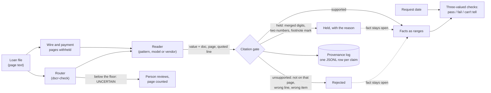

# groundcheck

Title and loan-document checks that take no value on a reader's word. groundcheck v0.1 holds
two checks:

- **lienstack** reads a title report's Schedule B (a preliminary report, or Part II of an
  ALTA-style commitment) and the mortgage statements in a file, then checks the lien conditions a
  second-lien HELOC guide prints: the new line records second, behind a first lien seasoned 12
  months, with no senior line of credit, recorded tax lien, judgment or reverse mortgage. A
  recorded lien those rules don't name reads "can't tell" for a person, never "pass". Combined
  loan-to-value comes out as a range that only cited liens and cited balances can narrow.
- **dscr-check** routes a DSCR file's pages, reads the rent schedule, lease, note, tax bill,
  insurance declarations and association dues, and scores DSCR (qualifying rent ÷ PITIA) as a
  range against each overlay's floor. A missing lease, an expired policy or a garbled tax total
  can't pass a file; at best it reads "can't tell". Its Encompass half takes Ocrolus Capture
  output, stages the result in custom fields a processor accepts, and reconciles the eFolder by
  reading it back.

Both run on one rule. A reader (the pattern readers here, a model, or a vendor extractor) only
proposes a value and quotes the document, page and line that print it. Code decides whether the
value stands, and every check is three-valued over the range of values the documents allow: it
passes only if it holds for all of them, fails only if it holds for none, and otherwise says what
fact would settle it.

TypeScript on Node 22.18+, MIT. Every document in this repository is synthetic.

| | |
| --- | --- |
| Live against Encompass | **no**: tested against mocks built from ICE's public docs, checked 2026-11-01 |
| Live against Ocrolus | **no**: tested against fixtures built from Ocrolus's public docs, checked 2026-11-01 |
| Live model runs recorded | **none**: the model readers' recordings in `recordings/` are simulated, not model output |
| Outside keys | **none yet**: see `keys/README.md` |
| CI | written for Node 22 and 24; it hasn't run, because the repository isn't on GitHub yet |

## Why I built this

I was a loan officer at New American Funding from 2019 to 2021, licensed in 14 states, and back
on live loans at Loan Factory from June to August 2026. My files closed through title and
escrow. The lesson in this repository came from software I built myself:

- **December 14–15, 2025.** I built a one-day DSCR demo for a mortgage-tech company. Agents
  sorted loan PDF pages into seven classes, one of them `UNCERTAIN` for a person, extracted the
  rent schedule, and scored DSCR, and every reviewer's "Bad Output" click went into a golden set.
  The payment and expenses behind that score were hard-coded ($3,150 a month, $8,200 a year).
- **October 3, 2026.** Transcribing lenders' HELOC grids into my own HELOC engine, I found
  second-lien cells printed with merged tracked changes (`$375400,000`, `75%85%***`). I held them
  with a written reason instead of guessing. The same day I kept a DSCR cash-out grid blocked,
  because it turns on rent coverage, which that engine's questions don't ask.
- **October 5, 2026.** I pulled every price off that engine's page because no rate sheet could
  be proven current, and wrote the rule down: a value counts only if a dated source backs it on
  the day you ask.

That engine checks every borrower answer as a range, so "not sure" can never become a fit.
lienstack points the same rule at the title report: "Do you have another loan against this
home?" gets answered from recorded liens instead of a guess. dscr-check is the December demo
rebuilt with it, with the payment and expenses read from documents or left open.

## How it decides



**The citation gate** (`src/core/evidence.ts`). A proposed value is *supported* only if the
quoted text is on the cited page, sits on the one printed line that labels that field (and, for
a Schedule B item, inside that item's own numbered lines), and prints exactly that value. An
item is found by its number in the report's exceptions, so a Part I requirement can never stand
for the Part II exception with the same number, and an item's kind is read from the whole item as
printed, never from the part a reader quotes. If the quote prints something that can't be read as
one value, the value is *held* with the reason and never repaired: a model that turns
`$318400,000.00` into a clean `$400,000` and cites the right line still gets held. Anything else
is *unsupported*. Held and unsupported values leave the fact as wide as a missing page would.

**Dates are judged on the request day.** Title reports, statements, rent schedules and
association statements have an age limit; leases, tax bills and insurance policies count only
while their printed period covers the request date. A document dated after the request fails
closed. Of two title reports, only the newer counts; two with the same date can't tell.

**Presence and absence aren't symmetric** (lienstack). A lien printed on the current report
proves it exists, so it can fail a rule even when another page is missing. "No tax lien" is a
claim about every item, so it can pass only when the report is whole (every "Page i of N" is
there), fresh, and every numbered exception was read with a kind the printed text supports. The
coming year's property taxes "not yet due or payable", and a commitment's standard exceptions
that mention liens, are not recorded liens. An absence rule names every item that fails it.

**A title report prints what a lien recorded, not what is owed.** A balance comes only from a
current statement whose original principal (or credit limit) matches exactly one lien's
recorded amount, and a balance above that amount is held.

**Qualifying rent** (dscr-check) is the lesser of the current lease and the rent schedule's
market rent, so a missing lease widens rent to "anything up to market" and no floor can pass.
**PITIA** is the note's principal and interest, which stands only when the printed payment and
every printed term (principal, rate, term) are backed and agree; the current tax bill and
insurance declarations; and association dues.

## Readers

| Reader | What it is | Where its proposals come from |
| --- | --- | --- |
| `reference` | Pattern readers for layout A's preliminary reports and the DSCR files | `src/lienstack/read.ts`, `src/dscr/read.ts` |
| `claude-json` | Model reader A, JSON with quotes: one Messages API request with structured outputs (`output_config.format`, a JSON schema); every value carries `{value, doc, page, quote}` | recordings |
| `claude-citations` | Model reader B, native citations: each page is a custom-content document with one block per line (a wrapped exception kept whole); the model writes `doc\|field: value` lines and cites a block | recordings |
| Ocrolus Capture | dscr-check's vendor reader: documented `raw_fields` keys mapped to DSCR parts, as vendor-field evidence | a Book's form data |

Citations and structured outputs can't share a request (the API returns a 400), so A and B are
separate readers under the same gate. A citation's pointer is guaranteed to name a block that
exists; it doesn't make the value right. Reader B reads the value from the model's own text and
the gate checks that the cited block prints it. Because a block is a whole exception, B can't
tell an item's "dated" day from its "recorded" day; a quote-level reader can.

A refusal, a response cut off at `max_tokens`, or JSON that doesn't match the schema is **no
reading**, never an empty one, so every fact it would have backed stays open. Both readers use
`claude-opus-5-5` and ask for no fallback model: a recording answered by another model is
refused, because a reader's score belongs to one model.

**Payment instructions never reach a model** (`src/core/mask.ts`). A page that prints wire or
account instructions is replaced before any request is built, the schema has no field for payment
data, and a test fails if the canary on layout B's synthetic wire page (`alta-10`) appears in any
built or recorded request.

**Recordings** (`recordings/<reader>/<file>.json`) hold the exact request and the response, and
replay in CI with no key. Replay rebuilds the request from the current code and refuses a
recording whose prompt, request or serving model has changed. The 24 recordings here are
**simulated**: `scripts/simulate.ts` writes them in the documented response shapes from what each
file prints, with planted reader mistakes (a lien amount backed by the statement, a Part I line
quoted as an exception, a paraphrased beneficiary, a "dated" day as the recording date, a
max_tokens cut-off, a refusal). They test the parser, the gate and the eval. They measure no
model. To record a model on your own key: `node scripts/record.ts --live --reader claude-json
--layout title-b`, then `pnpm eval` and, on purpose, `node src/cli.ts eval --pin`.

## Two layouts

- **Layout A** (`examples/title/`): six California-style preliminary reports, written by hand.
- **Layout B** (`examples/title-b/`): twelve commitments shaped like the ALTA Commitment for
  Title Insurance (2021 v. 01.00): Schedule A, Schedule B Part I (requirements) and Part II
  (exceptions), from a second generator (`scripts/layout-b.ts`) with its own wording and traps in
  other places: a merged recording date, a footnote mark on a statement balance, two amounts run
  together on a tax lien, a line of credit named on an exception's second line, a requirement to
  release a deed that Part II still lists, a missing Part II page, wire instructions, a stale and a
  superseded commitment, and standard exceptions that mention liens. A test fails if the committed
  files drift from the generator.

## Eval

`pnpm eval` scores each reader on each layout through the gate, against that layout's key, and
compares every count with `eval/baseline.json`. One more unsupported value, one fewer must-hold key
held, or one more wrong field fails CI.

Measured in this repository on November 1, 2026 (synthetic files; who keyed them is in
`keys/README.md`):

| Reader on layout | Fields | Correct | Wrong | Missed | Unsupported proposals | Must-hold held | Rule results can't tell |
| --- | --- | --- | --- | --- | --- | --- | --- |
| reference on A (circular: written for these files) | 111 | 111 | 0 | 0 | 0 of 111 | 1 of 1 | 9 of 48 |
| reference on B | 257 | 27 | 0 | 230 | 0 of 27 | 0 of 3 | 96 of 96 |
| claude-json on B, **simulated responses** | 257 | 231 | 4 | 22 | 4 of 235 | 3 of 3 | 45 of 96 |
| claude-citations on B, **simulated responses** | 257 | 233 | 3 | 21 | 2 of 236 | 3 of 3 | 36 of 96 |

What the rows say: the pattern reader written for layout A reads only statement lines in layout
B and can't tell a single rule, which is the right answer for a reader that doesn't know the
layout. The two model rows are the simulated mistakes coming back through the gate as designed;
they are not a model's accuracy. dscr-check's reference reader gets 94 of 94 hand-keyed fields
(`pnpm eval` prints it too), also circular.

## Soundness

Tested on every example file:

- Removing every single page and every pair of pages never makes any result more certain
  (lienstack checks, verdicts, CLTV and the HELOC facts; dscr-check overlays, DSCR and each part).
- Replacing any one printed amount or percent with merged-edit residue (`$318412,000.00`,
  `7%7.125%`) never makes any result more certain. This found a hole: a garbled principal let a
  note's printed payment through unchecked, turning overlay A from can't tell to fail on dscr-06.
- Adding an older copy of the current report never changes a result.
- Printing Schedule B items in another order never changes a result. This found the absence rules
  naming items in reader order.

Not sound, and said so: when two current documents disagree, a part widens to both values, and
losing one of them narrows it again. Without a manifest of what a file should contain, a missing
document can't be told from one that was never there.

## Provenance log

`--audit log.jsonl` appends one row per gated claim: the file's SHA-256, the document, page and
quote, the reader with its version and prompt hash, the gate's status and reason, and the hash of
the line before it, so an edited, dropped or reordered line no longer verifies
(`src/core/audit.ts`). A person resolving a held value adds a row with their name in `decidedBy`;
the held row never changes. Every report also prints the input file's SHA-256.

## The Encompass half of dscr-check (on mocks)

This doesn't classify or attach documents for Ocrolus: Ocrolus Classify already watches the
"Ocrolus Processing Required" eFolder container, routes unsupported pages to UNKNOWN and copies to
Duplicate Attachments. This sits around it:

- **Ocrolus Capture adapter** (`src/ocrolus/capture.ts`). Maps the documented field keys of six
  form types to dscr-check's parts: 1007 market rent (Part05, "I (We) Estimate the Monthly Market
  Rent of the Subject to Be"), lease rent and term, the note's principal, rate, payment and dates,
  the tax bill, the insurance policy and the association statement. Capture's `raw_fields` carry a
  value, a confidence and a filename but no page or quote, so they are a second, weaker kind of
  evidence (`src/core/vendor.ts`): a vendor field stands only if it came from the form type that
  carries it, isn't empty, clears a confidence floor and parses as one value; a garbled one is held.
  Three mappings are decisions to confirm with a lender: the 1007's report signed date dates it; a
  tax bill is current when issued within 365 days, since TAX_BILL has no fiscal period; and
  `totalTaxesDue` is the annual tax only when its installments add up to it.
- **Staged fields, never a processor's** (`src/encompass/staging.ts`). Encompass merges concurrent
  edits and the last update wins, so the connector writes only its own `CX.ED.*` custom fields, in
  one call, and refuses any other field before sending.
- **The processor decides** (`src/encompass/ssf.ts`). An SSF guest's logic over `elli.script`'s loan
  object: each staged value beside the loan's current value and its source; Accept calls
  `setFields` and `commit()` in the processor's session; Keep changes only the review status.
  `enhancedfieldchange` events become `writtenBy` rows, and a processor's value that differs from
  the staged one becomes a golden-set entry. The milestone check reads only local state, inside the
  web's 1-second limit; an admin's milestone rule on `CX.ED.STATUS` is the sturdier choice.
- **Attach at most once** (`src/encompass/attach.ts`, `migrations/001_ledger.sql`). The ledger is
  SQLite in WAL mode, keyed by (loan GUID, SHA-256, container) and attempt, never by attachment
  ID. The row is written before any request, a write is never retried, and a lost answer is
  settled by reading: by attachment ID, then by the `ED-` title tag, then by downloading and
  hashing. Kill tests cover the three crash points (after the URL, after the PUT, after the
  commit). A file that can't be found closes as `unconfirmed_never_resubmitted` in a named queue;
  only a person resubmits it. The rule is the one from my payment client for TASK: "No money
  operation is automatically retried. Persist request IDs before calls and reconcile an uncertain
  outcome before issuing a replacement operation."
- **Reconciler** (`src/encompass/reconcile.ts`). Health comes only from reading the eFolder and the
  Book back: confirmed and missing files by hash, stuck files, UNKNOWN pages, duplicates, rejected
  documents, a push Ocrolus stopped retrying after 12 hours, and whether the webhook subscription
  still exists. The Book is found with Book-from-loan by loan GUID, never by name.
- **Intake, subscription, metering, auth.** Webhooks are verified, enqueued durably and only then
  answered 2xx; a transient fault answers 503, never a 4xx, which Encompass wouldn't retry. The
  subscription asks for exponential delivery (8 hours) instead of three tries then discard.
  Concurrency is metered on `X-Concurrency-Limit-Remaining` at 20% of the limit for an ISV and 80%
  for a lender's own integration, with backoff on 429 and a separate 20-a-second budget for
  Ocrolus. The token request is the password grant through an API user, never `client_credentials`.

`pnpm demo:encompass` runs it all on the mocks. The mocks (`src/encompass/mock.ts`,
`src/ocrolus/mock.ts`) and the fixture (`fixtures/ocrolus/book-forms-dscr.json`) are
**doc-derived**: built from the public pages named in each test's title, checked 2026-11-01, not
recorded. Nothing could be recorded: there are no credentials. Two behaviors are assumptions until
a sandbox run: that a Developer Connect subscription signs with `Elli-Signature` as Partner
Connect's docs describe, and whether creating an upload URL leaves an empty attachment record.

**What it takes to make it live**, per ICE's docs: the lender's Developer Connect access; a super
administrator who retrieves the API key for each instance, starting with a test instance (usually
`TEBE…`); an API user on a dedicated, least-privilege persona with eFolder access, the `CX.ED.*`
fields and Subscribe to Webhooks; the lender's mapping from each staged field to the loan field a
processor may accept it into; and, for the Book, the lender's own Ocrolus agreement. Until then the
badge above stays "no".

The service is TypeScript in this repository, beside dscr-check, rather than a separate Python
(FastAPI) service, and the review form is the SSF guest's logic without a UI framework; a lender
deployment would host both in its own cloud tenant.

## Run it

```bash
pnpm install
pnpm test                                             # 259 tests
pnpm typecheck
pnpm lienstack examples/title/title-03.json           # any file in examples/title or examples/title-b
pnpm lienstack examples/title/title-01.json --as-of 2026-12-15
pnpm dscr examples/dscr/dscr-02.json --json
pnpm eval                                             # every reader and layout, against eval/baseline.json
pnpm demo:encompass
```

`title-03`: the first lien's recorded amount prints with merged digits.

```text
held or unsupported
  held  item 3 amount  prelim p.2: digits run together or break their grouping ('$318400,000.00')

checks
  PASS        title               "prelim" (effective 2026-10-09, 22 days old, whole, 4 items read)
  PASS        second-position     one mortgage lien stays ahead of the new line
  ...
  CAN'T TELL  cltv                recorded amount of 2021-0331870 is not backed, so no statement can be tied to it; limit 80%

CLTV 14.29% to unbounded
verdict: CAN'T TELL
```

`title-01 --as-of 2026-12-15`: the same clean file, 67 days later.

```text
  CAN'T TELL  title               "prelim" is 67 days old on 2026-12-15; the policy allows 60
  ...
verdict: CAN'T TELL
```

| File | What it shows | Result |
| --- | --- | --- |
| `title-01` | One seasoned first lien, current statement, whole report | pass, CLTV 67.32% |
| `title-02` | An open line of credit recorded in 2023 | fail (third position, senior line); passes with `payoff: ["2023-0456789"]` as a condition |
| `title-03` | Recorded amount with merged digits | can't tell (CLTV open) |
| `title-04` | Printed page 3 of 3 missing | can't tell on every rule |
| `title-05` | Federal tax lien and abstract of judgment | fail, naming both |
| `title-06` | September report superseded by October's | pass on October's |
| `alta-01` … `alta-12` | Layout B, one trap each (see `note` in each file) | as built: 3 pass, 3 fail, 6 can't tell with a reader that proposes what is printed |
| `dscr-01` | Complete file | DSCR 1.281: A pass, B pass |
| `dscr-02` | No lease | can't tell |
| `dscr-03` | Tax total with merged edits | can't tell (taxes held) |
| `dscr-04` | Insurance expired in March; a blank scan | can't tell; one page to a person |
| `dscr-05` | Association dues on a statement | DSCR 1.097: A fail, B pass |
| `dscr-06` | Printed payment its terms don't produce | can't tell (payment held) |

For the HELOC engine, lienstack also answers the three questions that engine asks the borrower
(`balance`, `otherLoan`, `otherBalance`), read from the title and statements instead, with the
balances as ranges. Unknown stays unknown, and an unknown balance is never zero. The engine
doesn't call it yet.

## What was tested

Measured in this repository, on synthetic files only, on Node 22.22: 259 tests with Node's test
runner, all passing, and a clean typecheck. Beyond the soundness and eval tests above:

- **Gate.** Merged digits, two numbers in one token, footnote marks and merged dates are held; a
  value quoted from the wrong document, page, line, Schedule B item or section is unsupported.
- **Model readers.** Request shapes (structured output schema closed and fully required, no
  numeric bounds, no payment field; one custom-content document per page with citations on);
  refusal, max_tokens, non-JSON and off-schema responses as no reading; stale and other-model
  recordings refused; the live recorder sends exactly the built request through the Anthropic SDK
  to a local stand-in server, never the API.
- **Golden set.** Seven hand-written DSCR bad outputs replayed through the gate stay rejected.
- **Fixture lint.** No SSN-, account-, email- or phone-shaped strings in examples, recordings or
  fixtures, and every example is marked synthetic. The loader refuses a file that isn't.
- **Encompass and Ocrolus**, on the doc-derived mocks: the attach kill tests, the reconciler's
  read-path health, staging, the review form, intake, delivery policies, metering and auth.

Not tested: real title reports or loan documents, PDFs or OCR, any live model, any live Ocrolus or
Encompass instance.

## Limits

- Input is page text. There is no PDF or OCR step; a scanned page should go to a person, and
  nothing here reads one.
- The pattern readers are written for their synthetic layouts. The model readers have no live
  recording yet, so nothing here says how well any model reads.
- Every key is the work of the files' author or generator; no outside keyer has checked one.
- lienstack's rules come from the lien conditions a public second-lien HELOC guide prints
  (rev. 2025-01-22, pp. 6–8). The 60-day title and statement limits are example settings. It does
  not read forbearance, negative amortization, balloons, private first liens or vesting history;
  each report lists them as not read. Lien kinds come from printed phrases written for these two
  layouts; a real report's wording needs its own cases.
- dscr-check covers a single-unit property with a fixed-rate, fully amortizing note. The two
  overlays and the policy ages are fictional settings. A reader that skips a second document of a
  kind it already read isn't caught.
- The Encompass half has run only against mocks. The lender's target field ids, the signature
  scheme, the empty-record question and every retry and lock behavior need a test instance.

## Layout

```text
src/core/        interval rule, dates, citation gate, vendor-field gate, mask, provenance log, loader
src/lienstack/   title reader, lien rules, CLTV, HELOC facts
src/dscr/        router, reader, DSCR check, overlays, eval
src/readers/     model readers A and B, recordings, live recorder
src/eval/        title eval per reader and layout
src/ocrolus/     Capture adapter, doc-derived mock
src/encompass/   mock, ledger, attach, reconciler, staging, SSF form, intake, metering, auth
scripts/         layout-B generator, simulated recordings, live recorder, Encompass demo
examples/        synthetic title (layouts A and B) and DSCR files, keys, golden bad outputs
recordings/      model reader recordings (simulated today)
fixtures/        doc-derived Ocrolus fixture
migrations/      the ledger's SQL
eval/            pinned eval baseline
keys/            how outside keys are recorded
test/            unit, soundness, eval, reader, Encompass and fixture tests
```

## License

MIT. Copyright (c) 2026 Jacob Lopez.
